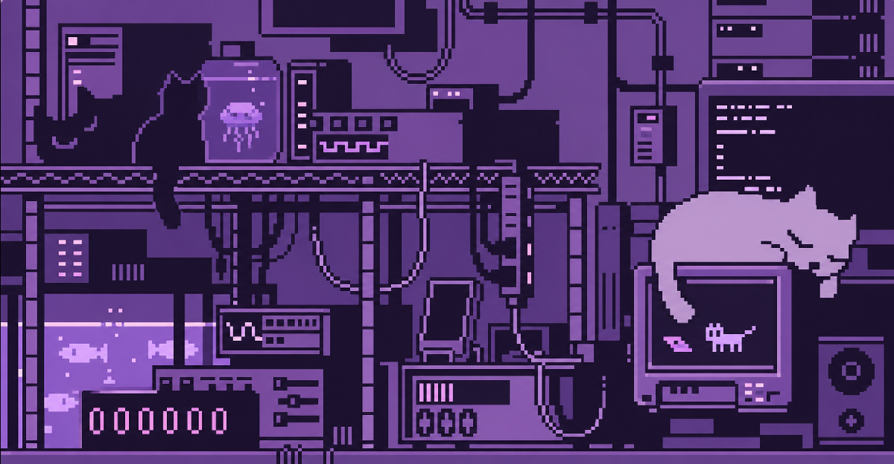

 

### > hello, world! i'm oleksandra_

**mathematics · data science · curious experiments · meaningful ideas**

finding patterns in chaos, one notebook at a time.

---

### `01 / about me`

Hi, I'm Oleksandra — a mathematics and data science student who enjoys understanding why things work, exploring patterns, and turning ideas into useful projects.

I'm especially interested in the intersection of mathematics, artificial intelligence, and technology that makes a difference.

- Currently studying mathematics, statistics, and data science.
- Exploring LLM evaluation, data visualization, and product analytics.
- Helping develop [MathPDF](https://mathpdf.site), an AI-powered learning platform.
- Interested in thoughtful design, meaningful products, and independent projects.

---

### `02 / selected projects`

*A collection of things I've built, explored, and learned from.*

#### 01 — MathPDF
**An AI-powered workspace for learning.**

[Website](https://mathpdf.site)

A study platform designed to help students work with their own learning materials more effectively.

Combines PDF reading and annotation with AI-generated flashcards, practice tasks, and tests in a single workspace.

My work focuses on product ideas, feature requirements, testing, and understanding what students actually need.

`EdTech` · `AI` · `Product Development` · `User Research`

#### 02 — mathpdf-metrics
**Making AI quality measurable.**

[GitHub repository](https://github.com/olexandratabakova/mathpdf-metrics)

A project exploring ways to evaluate the quality of AI-generated educational content.

Focused on structured evaluation, prompt comparisons, and metrics that can help identify opportunities for improvement.

`Python` · `LLM Evaluation` · `Metrics`

#### 03 — ConnexaData2025
**Exploring data through code.**

[GitHub repository](https://github.com/olexandratabakova/ConnexaData2025)

A repository documenting part of my development journey and experimentation with data-related projects.

#### 04 — VisualConnexa
**Exploring the visual side of programming.**

[GitHub repository](https://github.com/olexandratabakova/VisualConnexa)

A project from my coding journey focused on exploring visual approaches and working with data.

#### 05 — theBeatles
**A project from my early coding journey.**

[GitHub repository](https://github.com/olexandratabakova/theBeatles)

One of my programming projects, reflecting my curiosity and hands-on approach to learning.

---

### `03 / currently exploring`

`Python` · `Mathematics` · `Statistics` · `Data Science` · `LLMs` · `Model Evaluation` · `Data Visualization` · `Product Analytics`

I'm interested in more than making things work. I want to understand the reasoning behind them, measure their quality, and find ways to make them better.

---

### `04 / a little more about me`

I like mathematical problems that require a different perspective, projects that begin as random ideas, and interfaces that make complicated things feel simple.

Still learning, still experimenting, and slowly building a collection of things I'm proud of.

---

powered by curiosity, late-night ideas & a little bit of purple.

